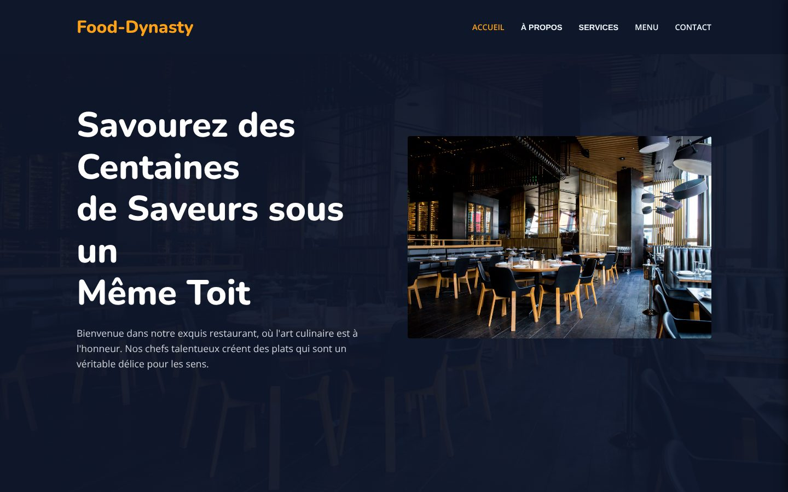

# Food-Dynasty : site vitrine de restaurant

Site vitrine d'un restaurant fictif en React : accueil, présentation, services, carte des plats et page contact avec plan d'accès.


**Démo en ligne :** [fooddinastyvitrinesite.vercel.app](https://fooddinastyvitrinesite.vercel.app)



> Projet d'entraînement au développement assisté par l'IA, sur un restaurant imaginaire.

## Pages

| Route | Contenu |
|---|---|
| `/` | Accueil, présentation et services |
| `/menu` | Carte des plats |
| `/contact` | Coordonnées et carte Google Maps intégrée |

## Stack technique

React 19, Vite, React Router 7 et react-icons, déployé sur Vercel.

## Installation

```bash
git clone https://github.com/medazero01-art/fooddinastyvitrinesite.git
cd fooddinastyvitrinesite
npm install
npm run dev
```

## Structure

```
src/
├── components/   # Navbar, Hero, About, ServiceSection, Footer, ScrollToTop
├── pages/        # Home, Menu, Contact
├── App.jsx       # Routes
└── main.jsx
```

## Auteur

**Ayoub Touat** · [@medazero01-art](https://github.com/medazero01-art)
